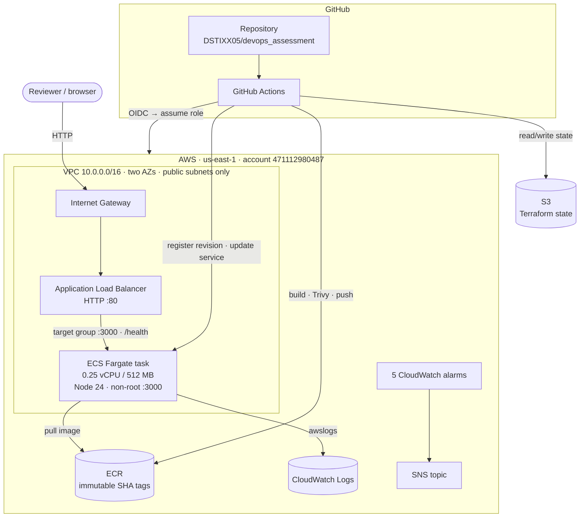
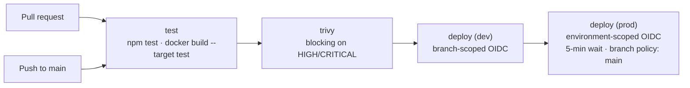

# DevOps Assessment - containerised Node service on AWS ECS Fargate

A small Express service deployed to **Amazon ECS on Fargate** behind an **Application
Load Balancer**, provisioned with **Terraform** into two independent environments
(`dev` and `prod`), and shipped by **GitHub Actions using OIDC**, with no long-lived AWS
credentials anywhere in the repository.

The application is deliberately unremarkable. It exists so the surrounding platform
has something real to deploy, monitor, break and roll back.

> **Status: torn down.**
> The stack was destroyed at the end of validation to stop the AWS bill. There is
> nothing running right now, so the load balancer URLs no longer resolve.
> Every claim below is backed by captured evidence in [docs/acceptance.md](docs/acceptance.md)
>, screenshots of the pipeline, the running service and the teardown.
> To bring it back up, follow [docs/runbooks/deployment.md](docs/runbooks/deployment.md).
> It takes about ten minutes.

---

## Start here

| If you want to…                                     | Go to                                                                                      |
| --------------------------------------------------- | ------------------------------------------------------------------------------------------ |
| See it working without paying for AWS               | [docs/acceptance.md](docs/acceptance.md), screenshots + recorded API responses            |
| Understand the design in five minutes               | [docs/architecture.md](docs/architecture.md)                                               |
| Know _why_ it is built this way                     | [docs/design-decisions.md](docs/design-decisions.md)                                       |
| Redeploy it from scratch                            | [docs/runbooks/deployment.md](docs/runbooks/deployment.md)                                 |
| Tear it down again                                  | [docs/runbooks/teardown.md](docs/runbooks/teardown.md)                                     |
| See what it does **not** do                         | [docs/limitations.md](docs/limitations.md)                                                 |
| Read the build journal, including the defects found | [PROJECT_LOG.md](PROJECT_LOG.md)                                                           |
| Read the original brief                             | [production-ready-deployment-architecture.md](production-ready-deployment-architecture.md) |

---

## What is in the repository

| Path                                       | Contents                                                                            |
| ------------------------------------------ | ----------------------------------------------------------------------------------- |
| [`app/`](app/)                             | The Node service, Express 5, ESM, 34 tests, multi-stage Dockerfile                 |
| [`infrastructure/`](infrastructure/)       | Terraform: `bootstrap/`, `ci/`, reusable `modules/`, and `environments/{dev,prod}`  |
| [`.github/workflows/`](.github/workflows/) | `application.yml` (build → scan → deploy) and `infrastructure.yml` (fmt + validate) |
| [`docs/`](docs/)                           | Architecture, decisions, runbooks, evidence                                         |
| [`PROJECT_LOG.md`](PROJECT_LOG.md)         | Dated journal of decisions, incidents and corrections                               |

---

## Architecture at a glance



Full detail, component inventory, request flow, failure modes, network layout, is in
[docs/architecture.md](docs/architecture.md).

---

## Endpoints to evaluate

The service exposes six routes. Two exist purely so a reviewer can inspect it without
reading code.

| Method | Path            | Purpose                                                              |
| ------ | --------------- | -------------------------------------------------------------------- |
| `GET`  | `/docs`         | **Swagger UI**: interactive reference, click _Try it out_           |
| `GET`  | `/openapi.json` | The OpenAPI 3.0.3 document behind it                                 |
| `GET`  | `/api/status`   | Runtime status, returns the **Git SHA the image was built from**    |
| `GET`  | `/health`       | ALB and container health check; `503` once draining                  |
| `GET`  | `/`             | Service name, environment, version                                   |
| `POST` | `/api/echo`     | Validates and echoes a message, exercises parsing and error mapping |

`/api/status` is the one worth understanding. The pipeline reads `commitSha` back after
deploying and compares it to `$GITHUB_SHA`. That is what makes "the deploy succeeded"
a verified statement rather than an assumption.

```bash
ALB=http://<alb-dns-from-terraform-output>

curl -s $ALB/api/status | jq .
curl -s $ALB/openapi.json | jq '.paths | keys'
open $ALB/docs

# happy path
curl -s -X POST $ALB/api/echo \
  -H 'content-type: application/json' \
  -d '{"message":"  hello  "}'
# → 200 {"status":"ok","message":"hello","length":5,...}   (trimmed)

# both failure modes map to 400, not 500
curl -s -o /dev/null -w '%{http_code}\n' -X POST $ALB/api/echo \
  -H 'content-type: application/json' -d '{}'      # 400 validation_failed
curl -s -o /dev/null -w '%{http_code}\n' -X POST $ALB/api/echo \
  -H 'content-type: application/json' -d '{nope'   # 400 invalid_json
```

Validation rules: `message` is required, must be a string, non-empty after trimming,
and at most 500 characters.

---

## How it deploys

Two workflows, three triggers.

| Workflow             | Trigger                                       | Does                                                     |
| -------------------- | --------------------------------------------- | -------------------------------------------------------- |
| `application.yml`    | pull request, push to `main`, manual dispatch | build → test → Trivy scan → deploy `dev` → deploy `prod` |
| `infrastructure.yml` | changes to `infrastructure/`                  | `terraform fmt -check` and `validate` for all four roots |



Deployment mechanics and the OIDC configuration in detail are in
[docs/runbooks/deployment.md](docs/runbooks/deployment.md) and
[docs/design-decisions.md](docs/design-decisions.md).

**No AWS access keys exist in this repository, or in GitHub.** The workflow presents a
short-lived OIDC token to AWS STS and assumes a narrowly scoped role. The trust policy
matches on the repository's _immutable subject claim_, which embeds numeric owner and
repo IDs, worth knowing, because most published examples match only on
`repo:owner/name:ref:...` and will silently fail against a modern repository.

---

## Security posture

Stated plainly, because a security section that lists only strengths is not a security
section.

| Control                           | State                                                                    |
| --------------------------------- | ------------------------------------------------------------------------ |
| Long-lived AWS credentials in CI  | **None.** OIDC federation only                                           |
| Container runs as non-root        | Yes, uid 1000, `USER node`                                              |
| Package managers in runtime image | **Removed.** `npm`, `npx`, `corepack` deleted after install              |
| Base image patched                | `apk upgrade --no-cache` in build; removed 7 HIGH/CRITICAL findings      |
| Vulnerability gate                | Trivy blocks on HIGH/CRITICAL (`ignore-unfixed`)                         |
| Image tags mutable                | **No.** ECR repository is `IMMUTABLE`                                    |
| State encrypted and private       | SSE-S3, public access blocked, TLS-only bucket policy                    |
| Operator identity                 | Dedicated IAM user with MFA, **not** root; enforced by a precondition   |
| Traffic encrypted in transit      | **No.** HTTP only, no domain, so no ACM certificate                     |
| Tasks in private subnets          | **No.** Public subnets with public IPs; no NAT Gateway, by cost decision |

The last two rows are the honest ones. Both are deliberate and both are argued in
[docs/design-decisions.md](docs/design-decisions.md). Neither would survive a real
production review without a domain and a NAT Gateway.

---

## Cost

The two environments cost roughly **$50-$60 per month** while running. The ALB hourly
charge dominates; Fargate at 0.25 vCPU is a few dollars.

| Item                                      | Approx. monthly |
| ----------------------------------------- | --------------- |
| 2 × Application Load Balancer             | ~$36            |
| 2 × Fargate task (0.25 vCPU / 512 MB)     | ~$18            |
| ECR storage, CloudWatch logs, alarms, SNS | ~$2             |
| **Currently running: nothing**            | **$0**          |

A budget (`devops-assessment-monthly`, $30) with alerts at 50/80/100% of actual and
100% forecasted is applied by `infrastructure/bootstrap/`. It is intentionally below
the running cost: it is a tripwire, not a forecast.

---

## Limitations

This is not production-ready, and calling it that would be the least useful thing this
document could do. Known gaps, with reasoning and proposed next steps, are collected in
[docs/limitations.md](docs/limitations.md). The headline items:

- **HTTP only**: no TLS, because no domain was available
- **A single task**: one Fargate task per environment, so there is no high availability
  and no zero-downtime deployment, despite the ALB spanning two AZs
- **Public subnets**: tasks have public IPs and unrestricted egress
- **No autoscaling, no WAF, no rate limiting**

---

## Documentation map

```text
README.md                                   this file, the entry point
├── docs/
│   ├── architecture.md                     components, request flow, network, failure modes
│   ├── design-decisions.md                 each choice, the alternative, and the trade-off
│   ├── limitations.md                      assumptions · limitations · improvements
│   ├── acceptance.md                       evidence index: runs, commits, screenshots
│   ├── runbooks/
│   │   ├── deployment.md                   bootstrap → environments → pipeline → verify
│   │   ├── teardown.md                     destroy order, ECR prerequisite, recovery
│   │   └── operator-identity.md            why root was avoided, and the residual risk
│   ├── screenshots/                        16 images with an index explaining each
│   └── evidence/                          captured Terraform outputs and API responses
├── PROJECT_LOG.md                          dated journal: decisions, incidents, corrections
└── production-ready-deployment-architecture.md   the original brief
```

---

## Requirements to run this yourself

| Tool                                | Version    | Notes                                                          |
| ----------------------------------- | ---------- | -------------------------------------------------------------- |
| Terraform                           | 1.17.2     | pinned in `infrastructure/.terraform-version` and the workflow |
| AWS provider                        | 6.73.0     | pinned in `.terraform.lock.hcl`                                |
| Node.js                             | 24.14.1    | `.nvmrc`; `engines` requires `>=24 <25`                        |
| Docker                              | any recent | multi-stage build                                              |
| AWS CLI + an admin profile with MFA | v2         | used via `infrastructure/scripts/with-operator-creds.sh`       |
| `gh` CLI                            | any recent | for workflow dispatch and variables                            |

Terraform state lives in S3 and is locked with `use_lockfile`. Do not run two Terraform
operations against the same environment concurrently, the lock will refuse the second,
which is correct, but it costs a confused ten minutes. See
[docs/runbooks/teardown.md](docs/runbooks/teardown.md) for the recovery procedure.
