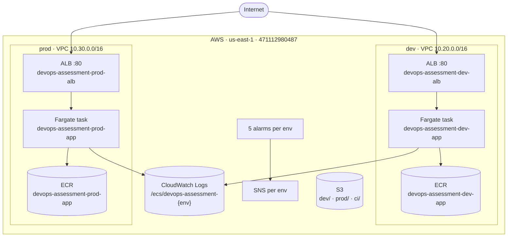

# Architecture

Back to [README](../README.md) · Related: [design decisions](design-decisions.md) · [limitations](limitations.md)

---

## Shape

One region, two independent stacks, one application image.



The two environments share **modules**, not resources. Destroying `prod` cannot affect
`dev`, and each has its own VPC, cluster, repository, log group, alarms and state key.

---

## Environments

|                    | `dev`                                       | `prod`                                              |
| ------------------ | ------------------------------------------- | --------------------------------------------------- |
| VPC CIDR           | `10.20.0.0/16`                              | `10.30.0.0/16`                                      |
| Name prefix        | `devops-assessment-dev`                     | `devops-assessment-prod`                            |
| State key          | `dev/terraform.tfstate`                     | `prod/terraform.tfstate`                            |
| Desired tasks      | 1                                           | 1                                                   |
| Deployed by        | `deploy-dev` job, **on any push to `main`** | `deploy-prod` job, **manual dispatch only**         |
| OIDC subject       | `repo:...:ref:refs/heads/main`              | `repo:...:environment:prod`                         |
| GitHub environment | none                                        | `prod`, with 5-minute wait and branch policy `main` |

The asymmetry is the point: `dev` validates every merge automatically, `prod` requires a
human to dispatch it and then wait.

---

## Components

| Component                               | Module               | Purpose                          | Notable settings                                                                                           |
| --------------------------------------- | -------------------- | -------------------------------- | ---------------------------------------------------------------------------------------------------------- |
| VPC, 2 public subnets, IGW, route table | `modules/networking` | Network boundary per environment | One subnet per AZ, `cidrsubnet(vpc_cidr, 8, i)`, AZs filtered to `opt-in-not-required`                     |
| Security groups                         | `modules/security`   | Least-privilege ingress          | ALB `:80` from `0.0.0.0/0`; task `:3000` **from the ALB security group only**, not from a CIDR             |
| ECR repository                          | `modules/ecr`        | Image registry                   | `IMMUTABLE` tags, `scan_on_push`, lifecycle: untagged 7d, keep 20 tagged                                   |
| ECS cluster, task definition, service   | `modules/ecs`        | Compute                          | Fargate, 0.25 vCPU / 512 MB, `X86_64`, awslogs driver, container-level health check                        |
| ALB, target group, listener             | `modules/alb`        | Ingress                          | `internal = false`, `target_type = "ip"`, health check `/health` expecting `200`, deregistration delay 30s |
| Log group, alarms, SNS                  | `modules/monitoring` | Observability                    | Retention set, 5 metric alarms, optional email subscription                                                |
| Two IAM roles                           | `modules/ecs`        | Task permissions                 | Execution role has `AmazonECSTaskExecutionRolePolicy`; **task role has no policies at all**                |
| Deploy roles + OIDC trust               | `ci/`                | CI federation                    | One role per environment, scoped to ECR push and ECS deploy                                                |
| State bucket, budget                    | `bootstrap/`         | Foundation                       | Versioned, SSE-S3, public access blocked, TLS-only, `use_lockfile`                                         |

---

## Request flow

1. A client resolves the ALB DNS name and connects to port 80.
2. The ALB security group permits `:80` from anywhere; the ALB listener forwards to the
   target group.
3. The target group holds the Fargate task's **IP address**, not an instance ID,
   `target_type = "ip"` is required for Fargate because tasks have no instance.
4. The task security group accepts `:3000` **only from the ALB security group**. A
   request from the internet directly to the task IP would be dropped, but see
   [limitations](limitations.md), the task does have a public IP.
5. Express handles the request. `correlationMiddleware` assigns or validates
   `x-request-id`, `accessLogMiddleware` emits one JSON line on completion.
6. The response returns through the ALB. `keepAliveTimeout` (65s) is deliberately
   **below** the ALB idle timeout (70s), so the task closes the connection first and the
   ALB never tries to reuse one the task has already dropped.

> **Idle timeout note:** the ALB sets `idle_timeout = 70` and the Node server sets
> `keepAliveTimeout = 65_000` with `headersTimeout = 66_000`. The application timeout is
> deliberately _below_ the load balancer's, so the server closes first and the ALB never
> tries to reuse a connection the task has already dropped. Inverting those two numbers
> produces intermittent 502s under low traffic, the classic ALB/Node mismatch.

---

## Network layout

| Item               | Value                                                                                                                              |
| ------------------ | ---------------------------------------------------------------------------------------------------------------------------------- |
| VPC                | `/16`, one per environment                                                                                                         |
| Public subnets     | Two, one per AZ, `/24` each via `cidrsubnet`                                                                                       |
| Availability zones | Resolved dynamically, filtered to `opt-in-status = opt-in-not-required` so `us-east-1e` (which lacks Fargate capacity) is excluded |
| Internet Gateway   | One per VPC; default route `0.0.0.0/0`                                                                                             |
| NAT Gateway        | **None**. A deliberate cost decision; see [design decisions](design-decisions.md)                                                 |
| Task public IP     | **Yes**: `assign_public_ip = true`, required to pull from ECR without a NAT                                                       |

Security group rules are created as standalone `aws_vpc_security_group_ingress_rule` /
`egress_rule` resources rather than inline blocks, so they can be reasoned about and
changed without replacing the group.

| Rule                | Direction | Source / destination | Port |
| ------------------- | --------- | -------------------- | ---- |
| `alb_http`          | ingress   | `0.0.0.0/0`          | 80   |
| `task_from_alb`     | ingress   | ALB security group   | 3000 |
| `alb_to_task`       | egress    | task security group  | 3000 |
| `task_outbound_all` | egress    | `0.0.0.0/0`          | all  |

`task_outbound_all` is broad and is called out rather than hidden: it exists so the task
can reach ECR and CloudWatch Logs without a NAT Gateway or VPC endpoints.

---

## Compute

| Setting          | Value                                                                                   |
| ---------------- | --------------------------------------------------------------------------------------- |
| Launch type      | Fargate, `runtime_platform` pinned to `X86_64`                                          |
| Size             | 0.25 vCPU / 512 MB                                                                      |
| Desired count    | 1                                                                                       |
| Base image       | `node:24.14.1-alpine`, patched with `apk upgrade --no-cache`                            |
| User             | `node`, uid 1000                                                                        |
| Package managers | `npm`, `npx`, `corepack` deleted from the runtime layer                                 |
| Health check     | `node -e "fetch('http://127.0.0.1:3000/health')"`, no `curl` added to the image        |
| Logging          | `awslogs` driver to `/ecs/<name_prefix>`                                                |
| Deployment       | `minimum_healthy_percent = 100`, `maximum_percent = 200`, circuit breaker with rollback |

Environment variables injected by the task definition: `APP_ENV`, `SERVICE_NAME`,
`COMMIT_SHA`, `HOST`, `PORT`, `LOG_LEVEL`, `SHUTDOWN_TIMEOUT_MS`.

`COMMIT_SHA` is what makes `/api/status` able to prove which build is running.

---

## Graceful shutdown

```
SIGTERM
  → app.beginShutdown()            /health starts returning 503
  → server.closeIdleConnections()  keep-alive connections dropped
  → server stops accepting new connections
  → exit 0 when the last request finishes
  → exit 1 if the shutdown timeout (default 10s) elapses first
```

The 503-before-close ordering matters: the ALB needs to see the task fail its health
check _before_ the listener goes away, otherwise requests in flight are dropped. This is
covered by four tests in `app/tests/shutdown.test.js`.

---

## Observability

Five alarms per environment, all publishing to an SNS topic with an optional email
subscription:

| Alarm                 | Metric                      | Fires when                    |
| --------------------- | --------------------------- | ----------------------------- |
| `target-5xx`          | `HTTPCode_Target_5XX_Count` | The application returns 5xx   |
| `unhealthy-hosts`     | `UnHealthyHostCount`        | The ALB has no healthy target |
| `live-task-count-low` | `LiveTaskCount`             | Below 1, the task is gone    |
| `ecs-cpu-high`        | `CPUUtilization`            | Above 80%                     |
| `ecs-memory-high`     | `MemoryUtilization`         | Above 85%                     |

Two details that are easy to get wrong, both found the hard way:

- The metric is `UnHealthyHostCount`, with a capital **H**. The wrong spelling creates an
  alarm that sits in `INSUFFICIENT_DATA` forever and looks identical to "no data yet".
- `live-task-count-low` uses `treat_missing_data = "breaching"`. A missing datapoint for
  a task count means the task is not reporting, which is a failure, not an absence of
  information.

ECR `scan_on_push` is enabled but **informational only**. The ECR scan is asynchronous
and cannot gate a pipeline. Trivy in CI is the blocking control.

---

## Failure modes

What breaks, and how you would find out.

| Failure                         | Effect                                   | Detected by                                                                                                                     |
| ------------------------------- | ---------------------------------------- | ------------------------------------------------------------------------------------------------------------------------------- |
| Task crashes on start           | ALB has no healthy target                | `unhealthy-hosts` alarm, `live-task-count-low` alarm                                                                            |
| Image pull fails                | Task never starts                        | ECS service events, `live-task-count-low`                                                                                       |
| Application returns 5xx         | Users see errors                         | `target-5xx` alarm                                                                                                              |
| Bad deploy                      | Circuit breaker rolls back automatically | Pipeline `services-stable` wait fails                                                                                           |
| Deploy succeeds but wrong image | Correct-looking deploy, wrong code       | `/api/status` `commitSha` compared to `$GITHUB_SHA` in the pipeline                                                             |
| Pipeline silently disabled      | No visible failure                       | **Not detected**. A workflow that never runs proves nothing; this is why the Trivy action version was pinned to a real release |
| State lock contention           | Terraform refuses to run                 | Explicit 412 error, see [teardown runbook](runbooks/teardown.md)                                                                |

---

## What this design does not give you

Single task count means no high availability despite the two-AZ ALB. HTTP only. Public
subnets. No autoscaling. These are decisions with reasons, not oversights, see
[limitations](limitations.md) and [design decisions](design-decisions.md).
