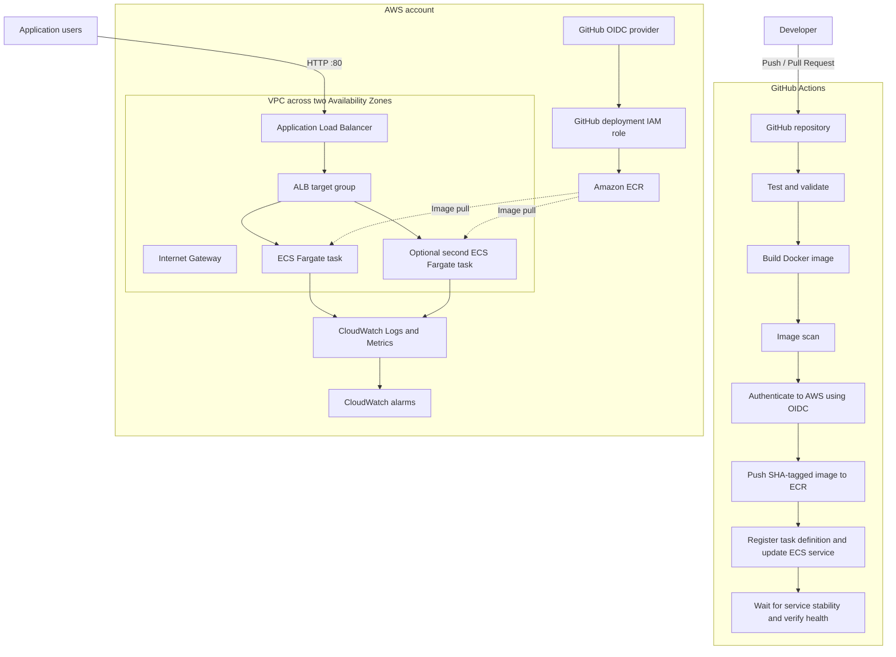
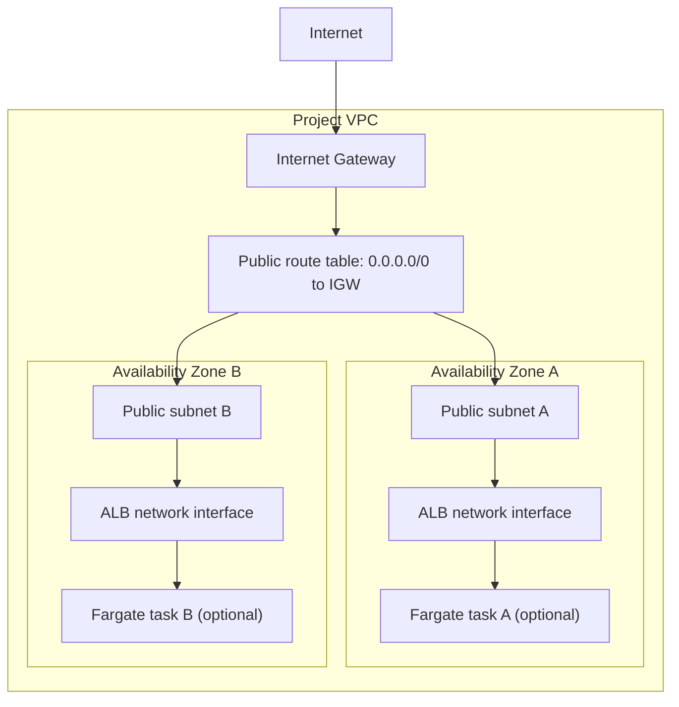
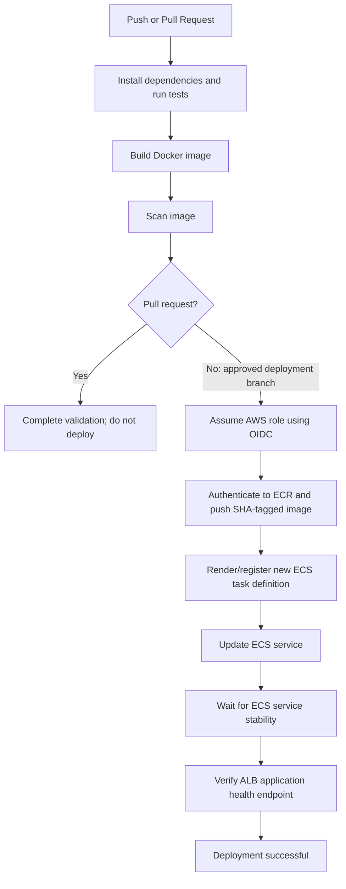

# Production-Ready Application Deployment

## Architecture Design Document

**Document version:** 1.0\
**Status:** Proposed architecture baseline\
**Prepared:** 14 November 2026\
**Target platform:** Amazon Web Services (AWS)\
**Application:** Node.js / Express REST API\
**Infrastructure as Code:** Terraform\
**CI/CD:** GitHub Actions\
**Container platform:** Amazon ECS on AWS Fargate

---

## 1. Executive summary

This document defines the proposed architecture for deploying a small,
containerized Node.js application to AWS. The solution is intended to
demonstrate practical DevOps engineering: repeatable infrastructure
provisioning, automated application delivery, containerization, basic
observability, security-conscious access control, and clear operational
documentation.

The design uses Amazon ECS with AWS Fargate, Amazon ECR, an Application
Load Balancer (ALB), Amazon CloudWatch, Terraform, and GitHub Actions.
GitHub Actions authenticates to AWS using OpenID Connect (OIDC),
avoiding long-lived AWS access keys in repository secrets.

The design deliberately balances production-oriented practices with the
cost constraints of a short technical assessment. It uses a two-AZ VPC
and ALB, while the initial ECS service may run one task to control cost.
This means the network and load-balancing layer spans two Availability
Zones, but the initial application deployment is **not fully highly
available**. A single task remains a single point of failure.

Because no domain name is available, the assessment deployment will
initially use the ALB-generated DNS name over HTTP. This is an
assessment limitation, not a recommended final production security
posture. HTTPS with an ACM certificate and a managed DNS name is a
documented production improvement.

The architecture is intentionally small. It excludes Kubernetes, a
database, a service mesh, and multi-region deployment because they are
not required by the application or assessment objectives.

## 2. Goals and success criteria

### 2.1 Goals

1.  Provision AWS infrastructure using modular, reusable Terraform.
2.  Containerize the application with Docker.
3.  Build an automated CI/CD pipeline using GitHub Actions.
4.  Store versioned container images in Amazon ECR.
5.  Deploy the application to Amazon ECS on Fargate without manual
    deployment steps.
6.  Expose the application through an Application Load Balancer.
7.  Collect application logs and infrastructure metrics in CloudWatch.
8.  Apply least-privilege IAM permissions and avoid long-lived CI
    credentials.
9.  Document design decisions, trade-offs, assumptions, limitations, and
    cleanup.
10. Make the deployment repeatable and straightforward for a reviewer to
    understand.

### 2.2 Success criteria

The solution is considered complete when:

- A reviewer can follow the README to understand the architecture and
  prerequisites.
- Terraform can create the required infrastructure from a clean,
  documented starting point.
- A pull request triggers validation and tests without deploying
  application changes.
- A change merged to the deployment branch builds and tags a Docker
  image using the Git commit SHA.
- The pipeline pushes the image to ECR and updates the ECS service.
- The pipeline waits for ECS service stability and verifies the
  deployed health endpoint.
- The application is reachable through the ALB DNS endpoint.
- Application logs are visible in CloudWatch.
- A failed test or build prevents deployment.
- The repository contains no credentials, Terraform state, or other
  secrets.
- The infrastructure can be destroyed using documented commands.

## 3. Scope

### 3.1 In scope

- A small stateless Node.js / Express HTTP API.
- Docker image build and local test workflow.
- Terraform-managed AWS networking and application infrastructure.
- Amazon ECR image repository.
- ECS cluster, task definition, and Fargate service.
- Application Load Balancer, listener, and target group.
- IAM roles for ECS task execution, application runtime, and GitHub
  Actions deployment.
- GitHub OIDC federation.
- GitHub Actions CI and deployment workflows.
- CloudWatch log group, application logs, and basic alarms.
- S3 remote Terraform state backend.
- Architecture diagrams and operational documentation.

### 3.2 Out of scope

- Kubernetes / Amazon EKS.
- Persistent application database.
- Multi-region active-active or disaster recovery.
- Service mesh.
- API Gateway.
- Advanced autoscaling policies unless time and cost permit.
- Web Application Firewall (WAF).
- Centralized security information and event management (SIEM).
- Full production certificate and DNS configuration, because no domain
  is currently available.
- Blue/green deployment using a separate deployment controller.

These exclusions are deliberate scope decisions. They can be revisited
if application requirements change.

## 4. Assumptions and constraints

---

Area Assumption or constraint

---

Cloud account The project will use the user's AWS
account.

Region One AWS region will be selected and
used consistently.

Application The service is stateless and does
not require persistent storage.

Runtime A supported Node.js LTS release
will be selected and pinned.

Port The application listens on TCP port
3000 inside the container.

Health endpoint `GET /health` returns HTTP 200 when
the process is ready to receive
traffic.

Domain No domain name is available for the
assessment.

Initial protocol HTTP through the ALB-generated DNS
name.

Availability Two AZs are used for the VPC and
ALB; initial task count is one
unless budget permits two.

Budget Avoid NAT Gateway and unnecessary
always-on services.

CI/CD GitHub Actions is acceptable under
the assessment instructions.

Infrastructure state Terraform state is stored remotely
in S3 after a one-time bootstrap.

Access Local infrastructure administration
and CI deployment use separate
identities.

---

### 4.1 Important availability qualification

A two-AZ VPC and ALB do not, by themselves, make the application highly
available. With one ECS task, a task failure or placement in an
unavailable AZ can interrupt service until ECS replaces it and the
replacement becomes healthy. Running at least two tasks with placement
across AZs improves resilience, but increases Fargate cost.

The README and architecture diagram must describe the actual task count
used during the final deployment. Do not label a one-task deployment as
highly available.

## 5. High-level architecture

### 5.1 Logical component diagram



### 5.2 Component responsibilities

---

Component Responsibility

---

GitHub repository Source code, tests, Dockerfile,
Terraform, workflows, documentation

GitHub Actions Validate, test, build, scan,
publish, and deploy

GitHub OIDC provider Establish trusted identity
federation from GitHub to AWS

GitHub deployment IAM role Allow only the AWS actions required
by the deployment workflow

Amazon ECR Store application container images

VPC Provide an isolated network
boundary

Public subnets Host the internet-facing ALB and,
in the cost-conscious assessment
design, Fargate task ENIs

Internet Gateway Provide internet routing for public
subnet resources

Application Load Balancer Accept inbound application traffic
and route it to healthy ECS targets

ECS cluster Logical grouping for ECS services
and tasks

ECS task definition Declare image, CPU, memory, port
mapping, logging, and runtime
configuration

ECS service Maintain the configured desired
number of tasks and manage
deployments

Fargate Run containers without managing EC2
worker instances

ECS task execution role Allow ECS/Fargate to pull images
and publish logs

ECS task role Provide application-specific AWS
permissions; initially no
additional permissions are expected

CloudWatch Store logs, expose metrics, and
evaluate alarms

S3 Terraform backend Store Terraform state remotely

---

## 6. AWS network architecture

### 6.1 Proposed topology

The VPC will span two Availability Zones in one AWS region. Each AZ will
have a public subnet. The ALB will be attached to both subnets.

For the initial cost-conscious assessment deployment, ECS tasks will
also use public subnets and receive public IP addresses. Security groups
will ensure that application traffic is accepted only from the ALB
security group. Tasks will not expose the application port directly to
arbitrary internet sources.



The diagram is conceptual. The ALB is one logical resource with network
interfaces in both selected subnets. ECS task placement is managed by
ECS and is not guaranteed solely by the visual arrangement.

### 6.2 Public-subnet task trade-off

**Selected for assessment:** public-subnet Fargate tasks with public IP
assignment, protected by a task security group that accepts the
application port only from the ALB security group.

Benefits:

- Avoids the hourly and data-processing charges of a NAT Gateway.
- Avoids the hourly charges of multiple interface VPC endpoints.
- Allows Fargate tasks to reach ECR and CloudWatch over public AWS
  service endpoints.
- Reduces networking components and setup time.

Costs and risks:

- Task ENIs have public IP addresses.
- The task relies on security-group rules to restrict inbound access.
- Outbound connectivity is not restricted to AWS service endpoints by
  default.
- This is less isolated than private-subnet compute.

A public IP does not mean the application port must be publicly
reachable. The task security group must allow inbound TCP port 3000 only
from the ALB security group. No rule should allow `0.0.0.0/0` to the
application port.

**Production evolution:** move ECS tasks to private subnets. Provide
required outbound access using a NAT Gateway or suitable VPC endpoints.
Evaluate the cost of ECR API, ECR Docker, S3 gateway, and CloudWatch
Logs connectivity against the workload's actual needs.

### 6.3 Security group rules

---

Security group Direction Protocol / Source / Purpose
port destination

---

ALB security Inbound TCP 80 `0.0.0.0/0` Assessment
group HTTP access

ALB security Outbound TCP 3000 ECS task Forward
group security group traffic to
application

ECS task Inbound TCP 3000 ALB security Accept traffic
security group group only from ALB

ECS task Outbound Required As required Outbound
security group egress for image service access
pulls, logs,  
 and  
 application  
 operation

---

Security group references should be used instead of broad CIDR rules for
ALB-to-task traffic. The ALB security group should not allow arbitrary
inbound application traffic on port 3000.

The task's outbound policy should be reviewed in the context of Fargate
image pulls and CloudWatch log delivery. Avoid claiming that outbound
access is restricted if the implementation uses unrestricted egress.

### 6.4 Load balancer configuration

- Scheme: internet-facing.
- Subnets: both public subnets.
- Listener: HTTP on port 80 for the assessment.
- Target type: `ip`, as required for Fargate task networking.
- Target port: 3000.
- Health check path: `/health`.
- Success matcher: HTTP 200.
- Health check interval and thresholds: choose sensible values and
  document them.
- Deregistration delay: retain a sensible default unless the
  application requires a different value.

The ALB should route only to healthy targets. The application must bind
to `0.0.0.0`, not only `localhost`, inside the container.

## 7. Application architecture

### 7.1 Application purpose

The application is a small stateless Node.js / Express API. Its purpose
is to provide a realistic container workload with testable endpoints and
observable runtime behavior, while keeping the assessment focused on
DevOps implementation.

### 7.2 Proposed endpoints

---

Endpoint Method Purpose Expected behavior

---

`/` GET Basic service Returns service
information name and a short
message

`/health` GET Load balancer and Returns HTTP 200
container health when ready
check

`/api/status` GET Runtime status Returns a small
JSON status
payload

---

Example health response:

```json
{
  "status": "ok"
}
```

The health endpoint should not depend on external services that are not
part of this application. If dependencies are introduced later,
readiness and liveness checks should be reconsidered separately.

### 7.3 Container requirements

- Use a supported Node.js LTS base image and pin an appropriate
  version.
- Use a multi-stage build if it provides a meaningful reduction in
  runtime image size.
- Run as a non-root user.
- Use a `.dockerignore` file.
- Install dependencies reproducibly using the lockfile and `npm ci`.
- Do not copy local secrets or development artifacts into the image.
- Expose/document port 3000.
- Handle `SIGTERM` and shut down gracefully.
- Write logs to standard output and standard error so the ECS
  `awslogs` driver can collect them.
- Do not bake environment-specific configuration or credentials into
  the image.

### 7.4 Health checks

Use both an ECS container health check and an ALB target-group health
check where appropriate.

- **Container health check:** verifies that the process inside the
  container responds locally.
- **ALB health check:** verifies that the service is reachable through
  the task network interface.

These checks cover different failure boundaries. They should not be
treated as interchangeable.

## 8. CI/CD architecture

### 8.1 Pipeline separation

Two independent workflows are proposed:

1.  **Application pipeline:** validates, tests, builds, scans,
    publishes, and deploys the application.
2.  **Infrastructure pipeline:** formats, validates, plans, reviews, and
    applies Terraform changes.

Application deployments must not run `terraform apply` on every
application code push. Infrastructure changes and application releases
have different review and rollback characteristics.

### 8.2 Application workflow



### 8.3 Trigger and deployment policy

Proposed policy:

- Pull requests: run tests, Docker build validation, and relevant
  static checks. Do not deploy.
- Pushes to the deployment branch (for example, `main`): run the full
  application pipeline and deploy after all checks pass.
- Terraform changes: use a separate workflow. Run `fmt`, `init`,
  `validate`, and `plan` on pull requests. Apply only after an
  explicit review/approval process on the protected deployment branch.
- Use GitHub environment protection for deployment approval if
  available and appropriate for the assessment.

### 8.4 Image versioning

Use the full Git commit SHA as the primary image tag, for example:

`<account-id>.dkr.ecr.<region>.amazonaws.com/<repository>:<commit-sha>`

Avoid deploying `latest` as the sole release identifier. A commit-SHA
tag makes it possible to identify the source revision associated with a
running task definition and simplifies rollback.

ECR tag immutability should be enabled where compatible with the tagging
workflow. If the pipeline also needs convenience tags, define their
behavior explicitly and do not use them as the only deployment
reference.

### 8.5 Deployment behavior and rollback

- Register a new ECS task definition revision that references the
  immutable image tag.
- Update the ECS service to use the new revision.
- Wait for the service to reach a stable state.
- Verify the ALB endpoint and health response.
- Enable the ECS deployment circuit breaker with rollback where
  supported by the selected deployment configuration.
- Preserve prior task definition revisions so a known-good version can
  be redeployed.
- Treat a failed health verification as a failed pipeline run.

The ECS deployment circuit breaker is not a substitute for
application-level testing. It detects deployment health problems through
service deployment behavior and health checks; the pipeline should still
verify the application endpoint.

## 9. Identity and access management

### 9.1 Identity separation

Use separate identities for separate responsibilities.

---

Identity Used by Responsibility

---

Human administrator Authorized operator Initial account setup
and controlled
infrastructure
administration

Terraform execution Local operator or Create, update, and
identity approved infrastructure destroy project
workflow infrastructure

GitHub Actions GitHub workflow through Publish images and
deployment role OIDC update the ECS service

ECS task execution role ECS/Fargate agent Pull ECR images and
publish CloudWatch logs

ECS task role Application container Application access to
AWS APIs, if later
required

---

Do not use the account root user for routine work. Protect privileged
human identities with MFA. Avoid using a permanent IAM user's long-lived
access key as the CI/CD credential.

### 9.2 GitHub OIDC trust

GitHub Actions should assume an AWS IAM role using the GitHub OIDC
provider.

The role trust policy should restrict:

- The expected GitHub organization or user.
- The exact repository.
- The intended branch or GitHub Environment subject.
- The `aud` claim to `sts.amazonaws.com`.

Do not use a wildcard trust policy that allows arbitrary repositories or
branches to assume the deployment role.

### 9.3 Permission boundaries

The GitHub deployment role should have only the permissions required to:

- Authenticate to the intended ECR repository.
- Upload image layers and image manifests.
- Register the required ECS task definition revision.
- Update and describe the intended ECS service and cluster.
- Describe tasks and deployments to wait for stability.
- Pass only the specific ECS task execution role and task role, using
  a narrowly scoped `iam:PassRole` permission.

The deployment workflow should not have broad administrator permissions.
Separate infrastructure provisioning permissions from application
deployment permissions.

The ECS task execution role and ECS task role are different roles. The
execution role supports ECS operations such as image pulls and log
delivery. The task role is made available to application code and should
remain minimally privileged.

## 10. Terraform architecture

### 10.1 Repository layout

```text
production-ready-deployment/
├── app/
│   ├── src/
│   ├── tests/
│   ├── package.json
│   ├── package-lock.json
│   ├── Dockerfile
│   └── .dockerignore
│
├── infrastructure/
│   ├── bootstrap/
│   │   ├── main.tf
│   │   ├── variables.tf
│   │   └── outputs.tf
│   │
│   ├── modules/
│   │   ├── networking/
│   │   ├── security/
│   │   ├── ecr/
│   │   ├── alb/
│   │   ├── ecs/
│   │   └── monitoring/
│   │
│   └── environments/
│       └── dev/
│           ├── backend.tf
│           ├── providers.tf
│           ├── main.tf
│           ├── variables.tf
│           ├── outputs.tf
│           └── terraform.tfvars.example
│
├── .github/
│   └── workflows/
│       ├── application.yml
│       └── infrastructure.yml
│
├── docs/
│   ├── architecture.md
│   ├── architecture-overview.mmd
│   └── decisions/
│       ├── ADR-001-compute-platform.md
│       ├── ADR-002-network-placement.md
│       ├── ADR-003-ci-cd-platform.md
│       └── ADR-004-identity-federation.md
│
├── .gitignore
└── README.md
```

This is a proposed structure, not a requirement to create a module for
every individual AWS resource. Modules should represent meaningful
infrastructure responsibilities and be reusable through clear input
variables and outputs.

### 10.2 Module responsibilities

---

Module Owns Important outputs

---

`networking` VPC, subnets, internet VPC ID, subnet IDs
gateway, route tables

`security` ALB and task security Security group IDs,
groups, IAM roles and role ARNs
policies where  
 appropriate

`ecr` ECR repository, image Repository URL and ARN
retention/lifecycle  
 configuration

`alb` ALB, target group, ALB DNS name, target
listener group ARN

`ecs` ECS cluster, task Cluster name/ARN,
definition, service service name

`monitoring` Log group, alarms, Log group name, alarm
dashboards if used identifiers

---

IAM resources may be separated further if that improves clarity. Avoid
circular module dependencies. Keep the environment root module
responsible for connecting module inputs and outputs.

### 10.3 State management

Use an S3 backend for Terraform state.

Recommended controls:

- S3 bucket with versioning enabled.
- Server-side encryption.
- Public access blocked.
- Bucket policy restricted to the Terraform operators/workflows.
- State locking using Terraform's S3 backend `use_lockfile`
  capability, supported by a compatible Terraform version.
- No state files committed to Git.
- No secrets placed in Terraform outputs or state unless absolutely
  unavoidable.

The backend bucket must exist before the environment can initialize
against it. A small bootstrap stage will create it. Bootstrap
instructions must be documented and must not imply that a backend can
create itself before it exists.

### 10.4 Terraform quality controls

The infrastructure workflow should run:

1.  `terraform fmt -check -recursive`
2.  `terraform init`
3.  `terraform validate`
4.  `terraform plan`

A plan should be reviewed before applying changes. Pin Terraform and
provider versions to tested compatible versions. Commit the dependency
lock file. Use variables for environment-specific values and provide
safe example files without credentials.

## 11. Monitoring, logging, and operations

### 11.1 Logging

Configure the ECS task definition to use the `awslogs` log driver.

- Create a dedicated CloudWatch log group for the application.
- Use a clear naming convention, such as
  `/ecs/<project>/<environment>`.
- Set log retention to seven days for the assessment.
- Write application logs to stdout/stderr.
- Prefer structured JSON logs with timestamp, severity, message, and
  request identifier where practical.
- Do not log passwords, tokens, authorization headers, or sensitive
  personal data.

### 11.2 Metrics and alarms

Proposed baseline:

---

Signal Source Purpose

---

ECS CPU utilization ECS / CloudWatch Detect sustained CPU
pressure

ECS memory utilization ECS / CloudWatch Detect memory pressure

ALB HTTP 5xx count or ALB / CloudWatch Detect application or
rate target errors

Healthy host count ALB / CloudWatch Detect loss of healthy
targets

Running task count ECS service / Detect service capacity
CloudWatch shortfall

---

At least one or two meaningful alarms should be implemented within the
assessment scope. Alarm thresholds should be documented as initial
operational thresholds, not universal production values. If an alarm
action such as email notification is configured, the notification
destination must be verified.

### 11.3 Operational checks

After deployment, verify:

- ECS service has the expected running task count.
- Tasks are healthy and using the expected task definition revision.
- ALB target group reports healthy targets.
- `/health` returns HTTP 200 through the ALB DNS endpoint.
- Application logs appear in the expected CloudWatch log group.
- The deployed image tag matches the Git commit SHA.
- No unexpected public inbound security group rules exist.

## 12. Security considerations

1.  Use MFA for privileged human access.
2.  Do not use root credentials for routine operations.
3.  Use GitHub OIDC rather than permanent AWS keys in GitHub secrets.
4.  Restrict OIDC trust to the intended repository and
    branch/environment.
5.  Scope IAM policies to required resources and actions.
6.  Restrict `iam:PassRole` to the ECS roles required by the service.
7.  Permit application ingress only from the ALB security group.
8.  Do not expose SSH or other administrative ports.
9.  Run the container as a non-root user.
10. Scan the container image and review findings before deployment.
11. Keep secrets out of source code, Docker images, logs, and Terraform
    variables committed to Git.
12. Encrypt Terraform state and restrict access to it.
13. Enable ECR image scanning where supported by the selected
    configuration.
14. Keep dependencies and base images maintained.
15. Document the public-subnet task placement and HTTP endpoint as
    assessment compromises.

### 12.1 HTTP limitation

The initial deployment uses HTTP because no domain is available for ACM
DNS validation. Traffic between users and the ALB will therefore not
have TLS encryption. This is not appropriate for sensitive application
traffic.

For production, acquire or use a domain, create the relevant DNS record,
request an ACM certificate in the same AWS region as the ALB, validate
the certificate, configure an HTTPS listener on port 443, and redirect
HTTP to HTTPS.

## 13. Trade-off analysis

---

Decision Selected Benefit Cost / Revisit when
approach limitation

---

Compute ECS Fargate Managed container Less host-level Workload requires
runtime, no EC2 host control; task Kubernetes or host
management runtime cost customization

Orchestration ECS rather than Lower operational No Kubernetes Kubernetes-specific
EKS overhead API/ecosystem requirements exist

CI/CD GitHub Actions Native GitHub Less control Jenkins is explicitly
integration, no over runner required or
Jenkins server infrastructure self-hosted execution
is needed

Registry ECR Native ECS/IAM Storage and Cross-cloud or
integration transfer charges registry portability
becomes a priority

Network Public-subnet Avoids NAT Gateway Public IPs and Workload handles
placement tasks and endpoint charges broader egress sensitive data or
path needs stronger
isolation

Availability Two-AZ VPC/ALB; Multi-AZ foundation One task is a Service requires
one initial with lower initial single point of stronger availability
task compute cost failure

Ingress ALB Health-based routing Hourly and Requirements change
and stable endpoint capacity charges to API Gateway or
another ingress

Protocol HTTP initially No No TLS Domain and ACM
domain/certificate encryption certificate are
prerequisite available

Monitoring CloudWatch Native AWS Ingestion, Advanced
integration retention, and observability
alarm costs requirements emerge

State S3 backend with Durable remote state Bootstrap and Not expected to
lockfile and locking access policy change for this
required project

Image tagging Git SHA Traceability and More image tags Retention policy
rollback to manage needs adjustment

---

## 14. Cost management

### 14.1 Main cost drivers

The primary cost contributors are expected to be:

- Application Load Balancer hourly and capacity charges.
- Fargate vCPU and memory runtime.
- Public IPv4 address charges.
- ECR image storage.
- CloudWatch log ingestion and storage.
- Data transfer.
- S3 state storage (expected to be small).

Actual cost depends on AWS region, runtime duration, traffic, image
size, and current AWS pricing. Do not quote a fixed monthly estimate
without checking the selected region and pricing model.

### 14.2 Cost controls

- Avoid NAT Gateways for the assessment topology.
- Avoid unnecessary VPC endpoints.
- Start with one ECS task; use two for the final availability
  demonstration only if budget permits.
- Use a small, measured Fargate task size.
- Set CloudWatch log retention to seven days.
- Configure an ECR lifecycle policy to expire old untagged or
  superseded images while retaining recent releases.
- Create an AWS Budget alert.
- Remove resources after the assessment if they are no longer
  required.
- Check for orphaned resources after Terraform destroy.

AWS Budget alerts are notifications, not hard spending caps. They do not
automatically stop resources or guarantee that spend cannot exceed the
configured threshold.

## 15. Failure scenarios and recovery

| Failure                             | Detection                               | Expected response / recovery                                                                            |
| ----------------------------------- | --------------------------------------- | ------------------------------------------------------------------------------------------------------- |
| Unit test fails                     | GitHub Actions test step                | Stop workflow; do not build or deploy                                                                   |
| Docker build fails                  | Build step                              | Stop workflow; inspect build logs                                                                       |
| Image scan finds unacceptable issue | Image scan step                         | Block release according to documented severity policy                                                   |
| AWS OIDC assumption fails           | Authentication step                     | Stop deployment; inspect trust policy and repository subject                                            |
| ECR push fails                      | Publish step                            | Stop deployment; inspect permissions, repository, and image tag                                         |
| ECS task exits                      | ECS service events and task status      | ECS attempts replacement to maintain desired count                                                      |
| Container health check fails        | ECS task health                         | Task may be replaced according to service behavior                                                      |
| ALB health check fails              | Target group health                     | ALB stops routing to unhealthy target; deployment may fail to stabilize                                 |
| New deployment does not stabilize   | ECS deployment state                    | Circuit breaker rollback where configured; inspect service events and logs                              |
| Application returns HTTP 5xx        | ALB metrics and application logs        | Investigate application errors and dependency behavior                                                  |
| One AZ becomes unavailable          | AWS service/AZ health and target health | A second healthy task in another AZ can continue serving; one-task configuration has reduced resilience |
| CloudWatch log delivery fails       | Missing logs / task configuration       | Inspect execution role, log group, and task definition configuration                                    |
| Terraform apply fails               | Terraform output and state              | Inspect error; resolve cause; check state consistency before retrying                                   |
| Terraform state lock remains        | Backend lock                            | Confirm no active operation, then follow documented safe lock recovery; do not force-unlock blindly     |

---

## 16. Validation and acceptance test plan

### 16.1 Application tests

- Unit tests pass locally and in GitHub Actions.
- `/health` returns HTTP 200.
- `/` returns the expected application information.
- `/api/status` returns valid JSON.
- The server listens on `0.0.0.0:3000`.

### 16.2 Container tests

- Docker image builds successfully.
- Container starts locally.
- Health endpoint responds from outside the container.
- Container runs as a non-root user.
- No local secrets or development files are included.
- Image scan is executed and findings are reviewed.

### 16.3 Infrastructure tests

- Terraform formatting and validation pass.
- Terraform plan contains only expected resources.
- VPC has the intended two public subnets in distinct AZs.
- ALB is attached to both public subnets.
- ECS tasks use the intended task security group.
- Task security group allows port 3000 only from the ALB security
  group.
- ECR repository and lifecycle configuration exist.
- CloudWatch log group has the intended retention.
- IAM trust and permissions are appropriately restricted.

### 16.4 Deployment tests

- Pull request workflow does not deploy.
- A successful merge to the deployment branch triggers the application
  pipeline.
- The image is pushed with the Git commit SHA tag.
- ECS task definition references the new image.
- ECS service reaches stability.
- ALB target is healthy.
- ALB DNS endpoint returns the expected health response.
- Logs are visible in CloudWatch.
- A deliberately failing test prevents deployment.
- A failed deployment is detected and rollback behavior is documented
  or demonstrated safely.

## 17. Architecture Decision Records

The following ADRs summarize the major choices. They should be stored as
individual files under `docs/decisions/` if the repository grows.

### ADR-001: ECS Fargate as the compute platform

**Status:** Proposed / accepted for assessment baseline

**Context:** The assessment requires an AWS-hosted container deployment.
The application does not require Kubernetes-specific features.

**Decision:** Use Amazon ECS with AWS Fargate.

**Consequences:** Avoids EC2 host administration and EKS control-plane
complexity. Reduces operational burden but provides less control over
the underlying compute host.

### ADR-002: Public-subnet ECS tasks for assessment cost control

**Status:** Proposed / accepted with explicit limitation

**Context:** Private-subnet Fargate tasks need a path to ECR and
CloudWatch. NAT Gateways and interface endpoints can add material fixed
cost to a small assessment environment.

**Decision:** Initially place Fargate tasks in public subnets with
public IP assignment. Restrict inbound application traffic to the ALB
security group.

**Consequences:** Avoids NAT Gateway and endpoint costs, but tasks have
public IPs and a less isolated egress path. This is not the preferred
production posture for sensitive workloads.

### ADR-003: GitHub Actions for CI/CD

**Status:** Proposed / accepted for assessment baseline

**Context:** The assessment accepts GitHub Actions or Jenkins and
prefers Jenkins. The project is hosted in GitHub and the delivery
pipeline is relatively small.

**Decision:** Use GitHub Actions.

**Consequences:** Native repository integration and no Jenkins server to
maintain. A self-hosted Jenkins environment may be preferable where
organizational requirements demand it.

### ADR-004: GitHub OIDC for AWS authentication

**Status:** Proposed / accepted

**Context:** Storing long-lived AWS access keys in GitHub Secrets
increases credential management risk.

**Decision:** Use GitHub OIDC federation and a narrowly scoped IAM role.

**Consequences:** Avoids permanent CI access keys. Requires a correctly
restricted trust policy and appropriate role permissions.

### ADR-005: One initial ECS task

**Status:** Proposed; validate against budget

**Context:** The assessment is cost-conscious, but the infrastructure
should demonstrate a two-AZ design.

**Decision:** Start with one task and make desired count configurable.
Increase to two tasks if the budget permits a stronger availability
demonstration.

**Consequences:** Lower compute cost, but a single task is a single
point of failure. Do not describe the one-task deployment as highly
available.

### ADR-006: HTTP endpoint until a domain is available

**Status:** Proposed; assessment-only limitation

**Context:** No domain is available for ACM DNS validation.

**Decision:** Use the ALB-generated DNS name over HTTP for the
assessment.

**Consequences:** Easy to access and validate, but traffic is not
encrypted in transit. Production requires a domain, ACM certificate,
HTTPS listener, and HTTP-to-HTTPS redirect.

## 18. Implementation sequence

The build should follow dependency order rather than creating resources
opportunistically.

---

Phase Work Exit condition

---

1\. Application Implement API, tests, App and container work
Dockerfile, local locally
health checks

2\. AWS foundation Select region, Correct account and
configure access, region verified
create budget alert

3\. Terraform bootstrap Create S3 state bucket Remote state
and configure backend initializes
successfully

4\. Networking and Create VPC, subnets, Network and access
security routes, security model reviewed
groups, IAM foundations

5\. Registry and Create ECR, ECS ECS service can start a
compute cluster, task task
definition, service

6\. Ingress Create ALB, target Health endpoint is
group, listener reachable through ALB

7\. Observability Configure CloudWatch Logs and selected
logs and alarms metrics visible

8\. CI/CD identity Configure GitHub OIDC Workflow can assume
and deployment role role with scoped
permissions

9\. CI/CD pipeline Implement test, build, Commit triggers
scan, push, deploy, repeatable deployment
verify

10\. Validation Run acceptance and Evidence collected and
failure tests issues resolved

11\. Documentation Finalize diagrams, Repository is
README, trade-offs, reviewer-ready
cleanup

---

## 19. Cleanup and teardown

The assessment environment should not be left running indefinitely.

Before teardown:

1.  Confirm the repository contains all required source and
    configuration.
2.  Record the final ALB endpoint and deployment evidence.
3.  Confirm no reviewer still needs the live endpoint.
4.  Run Terraform destroy from the correct environment and with the
    correct state.
5.  Verify that the ALB, ECS service/tasks, target group, security
    groups, and VPC resources have been removed.
6.  Decide whether to retain or remove the ECR repository and images.
7.  Retain the Terraform state bucket only if it is needed for future
    work; otherwise remove it after safely handling the state and
    versioned objects.
8.  Check the AWS console and billing/cost views for leftover resources.

Do not delete the remote state bucket before the infrastructure managed
by that state has been destroyed. Versioned S3 objects may need separate
cleanup.

## 20. Open items to confirm during implementation

The following values should be finalized before Terraform resources are
written:

- AWS region.
- Project name and resource naming convention.
- GitHub repository owner and repository name.
- Deployment branch and GitHub Environment name.
- VPC CIDR and subnet CIDRs.
- ECS task CPU and memory after local measurement.
- Initial ECS desired task count.
- Exact Node.js LTS and base image versions.
- Image scan tool and severity threshold.
- CloudWatch alarm thresholds and notification destination, if any.
- Terraform and AWS provider versions.
- Whether the final assessment run will use one or two ECS tasks.

Do not hardcode account IDs, credentials, or environment-specific
secrets in source files.

## 21. Final design position

The proposed solution prioritizes a clear and defensible deployment
lifecycle over architectural complexity.

It demonstrates:

- Infrastructure as Code with reusable Terraform modules.
- Automated CI/CD with separate infrastructure and application
  workflows.
- Containerization and immutable image versioning.
- AWS-managed container execution using ECS Fargate.
- Controlled ingress through an ALB.
- Identity federation using GitHub OIDC.
- Centralized application logging and basic monitoring.
- Explicit failure handling, cost controls, and documented production
  improvements.

The architecture is intentionally a **cost-conscious assessment
environment with production-oriented practices**, not a claim that every
production requirement has been implemented. Its
limitations---especially HTTP-only access, public-subnet task placement,
and a possible single-task service---are explicit and have documented
upgrade paths.

The implementation should preserve these decisions unless new evidence,
an AWS constraint, or a changed requirement justifies revisiting them.
Any material change should be recorded in the decision register and
reflected in the diagrams and README.

---

**End of architecture design document.**
